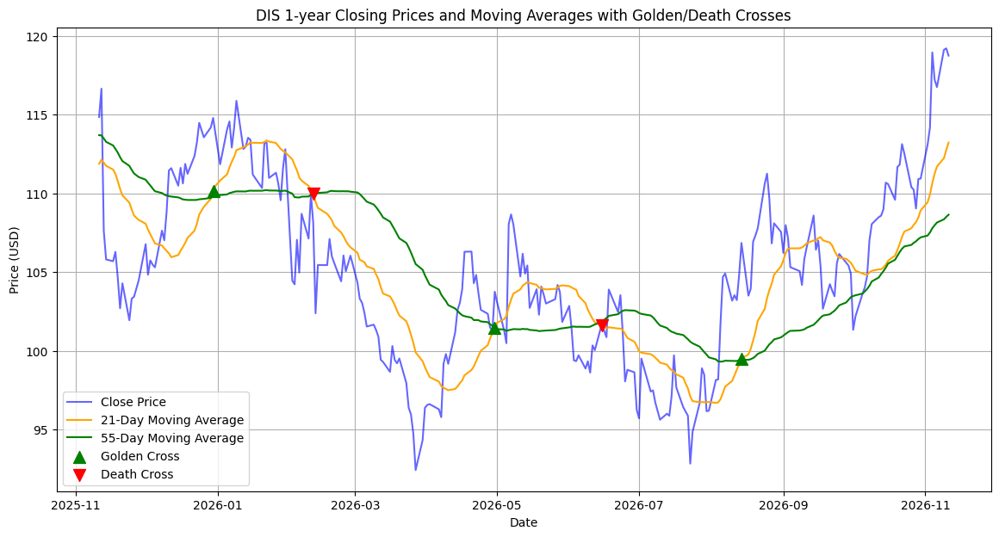
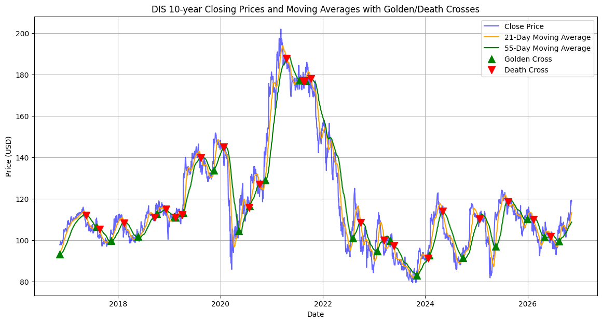

# Moving Average Crossover Trading Strategy Analysis

**CS533 PA3 | Python • Pandas • Financial Time Series • Strategy Backtesting**

[](https://colab.research.google.com/github/zhenyuwang0720/MA_Cross_Trading_Strategy_Analysis/blob/main/CS533_PA3_JimmyWang.ipynb)
[](./CS533_PA3_JimmyWang.ipynb)

> **Project summary:** Explore Disney (DIS) historical closing prices, calculate Fibonacci-period moving averages, identify Golden Cross and Death Cross signals, and evaluate a rule-based trading strategy. 

## Table of Contents

1. [Introduction](#1-introduction)
2. [Research Objectives](#2-research-objectives)
3. [Dataset](#3-dataset)
4. [Methodology](#4-methodology)
5. [Python Implementation](#5-python-implementation)
6. [Results](#6-results)
7. [Discussion and Limitations](#7-discussion-and-limitations)
8. [Conclusion and Future Work](#8-conclusion-and-future-work)
9. [Reproducibility](#9-reproducibility)

## 1. Introduction

Moving averages (MA) smooth short-term price fluctuations and help reveal longer-term trends. This project investigates whether crossover signals based on Disney's (DIS) historical daily closing prices can define a systematic buy-and-sell strategy.

A **Golden Cross** occurs when the short-term MA crosses above the long-term MA; for example, the 21-day MA crosses above the 55-day MA; a **Death Cross** occurs when it crosses below. A Golden Cross is usually considered a signal of buying, on the other hand, a Death Cross usually appears as a signal to leave the market.

**Research question:** How does the moving-average crossover strategy perform on the available stock historical data, especially over the most recent ten-year analysis window?

## 2. Research Objectives

- Calculate moving averages over the Fibonacci-related windows **21, 34, 55, 89, 144, and 233** trading observations.
- Visualize the stock closing price alongside a pair of short and long moving averages.
- Detect MA Golden Cross and Death Cross events.
- Simulate completed trades initiated by Golden Cross and closed by the next Death Cross.
- Compare the compounded return across completed strategy trades with the price change between the first strategy purchase and final strategy sale in the chosen window.

## 3. Dataset

| Attribute | Description |
| --- | --- |
| Asset | The Walt Disney Company (DIS) |
| Frequency | Daily observations |
| Historical period stated in the notebook | January 2, 1962 – November 11, 2026 |
| File | `DIS_1d_1962-01-02_2026-11-11.csv` |
| Main columns used | `Date`, `Close` |
| One-year view | Data from November 11, 2025 onward |
| Ten-year view | Data from November 11, 2016 onward |
| Source | **https://www.stockquote.io/stocks/DIS/history** |

Usage: The notebook converts `Date` to a datetime type, sorts observations chronologically, and calculates moving averages from the `Close` column.

**Dataset location:** [`data/DIS_1d_1962-01-02_2026-11-11.csv`](./data/DIS_1d_1962-01-02_2026-11-11.csv)

## 4. Methodology

### 4.1 Simple moving averages

For a window of `n` observations, the simple moving average is:

$$
\mathrm{SMA}_n(t)=\frac{1}{n}\sum_{i=0}^{n-1}P_{t-i}
$$

Here, `P` denotes the daily closing price, and the notebook computes moving averages for `n = 21, 34, 55, 89, 144, 233`, which is a portion of Fibonacci sequence.

### 4.2 Rationale for Using Fibonacci-Period Moving Averages

Traditional moving-average crossover strategies commonly use the 50-day and 200-day moving averages to identify long-term bullish and bearish trends. Although these indicators are widely recognized, their relatively long lookback periods may delay the identification of shorter-term trend reversals.

For this project, I explore an alternative approach using moving-average periods derived from the Fibonacci sequence: **21, 34, 55, 89, 144, and 233 trading days.**

The selection of Fibonacci periods is motivated by three primary considerations.

**a. Multi-Timeframe Trend Analysis**

Fibonacci periods provide a structured progression of observation windows. Shorter moving averages, such as MA21 and MA34, emphasize recent price movements, while longer periods, such as MA144 and MA233, help identify broader market trends. This allows the analysis to examine how short-term price behavior interacts with intermediate- and long-term trends.

**b. Signal Responsiveness and Detection Lag**

The conventional MA50/MA200 crossover is primarily designed to identify significant long-term trend changes. However, moving averages are lagging indicators, meaning they respond to price movements after those movements have occurred. By examining shorter Fibonacci-period combinations, such as MA21/MA55, this study investigates whether trend reversals can be identified earlier than with MA50/MA200. Earlier signals may improve responsiveness but may also increase false signals during sideways or volatile markets.

**c. Systematic Parameter Selection**

Rather than selecting arbitrary moving-average periods, the Fibonacci sequence provides a predefined and mathematically structured set of parameters. The sequence is associated with the golden ratio, approximately 1.618, although this mathematical relationship does not establish that Fibonacci-based indicators are inherently more accurate in financial markets. The purpose of selecting these periods is to explore how their different lookback windows affect crossover behavior and trading-strategy performance.

**Research Hypothesis**

This study investigates whether Fibonacci-period moving averages can provide useful alternative trading signals compared with the conventional MA50/MA200 approach, particularly in terms of signal timing, trading frequency, and cumulative returns. The objective is not to assume that Fibonacci-based strategies are superior, but to evaluate their performance empirically using historical stock-price data.

### 4.3 Cross-signal detection

A **Golden Cross** is flagged when **MA21 ≥ MA55 today** and **MA21 < MA55 on the previous observation**. A **Death Cross** is flagged when **MA21 < MA55 today** and **MA21 ≥ MA55 on the previous observation**.

### 4.4 Trading rules

1. **Buy** at the closing price of the day with a Golden Cross, provided no position is open.
2. **Hold** until the next Death Cross.
3. **Sell** at the closing price on that Death Cross day.
4. Record the trade's percentage return; evaluate completed buy–sell pairs only.

The return on a completed trade is:

$$
R_i=\frac{P_{\mathrm{sell},i}}{P_{\mathrm{buy},i}}-1
$$

The compounded return across `m` completed trades is:

$$
R_{\mathrm{cumulative}}=\prod_{i=1}^{m}(1+R_i)-1
$$

**Implementation assumption:** The notebook assumes same-day closing-price execution at the signal, without explicitly modeling fees, slippage, dividends, or the return on idle cash. This is a simplified historical simulation, not a live-trading model.

## 5. Python Implementation

The full implementation is in **[`CS533_PA3_JimmyWang.ipynb`](./CS533_PA3_JimmyWang.ipynb)**.

### 5.1 Libraries

```python
import pandas as pd
import numpy as np
import matplotlib.pyplot as plt
```

### 5.2 Calculate moving averages

```python
for n in [21, 34, 55, 89, 144, 233]:
    df[f'MA{n}'] = df['Close'].rolling(window=n).mean()
```

### 5.3 Identify crossover signals

```python
df['21above55'] = np.where(df['MA21'] >= df['MA55'], 1, 0)
df['Golden_Cross'] = np.where(
    (df['21above55'] == 1) & (df['21above55'].shift(1) == 0), 1, 0
)
df['Death_Cross'] = np.where(
    (df['21above55'] == 0) & (df['21above55'].shift(1) == 1), 1, 0
)
```

### 5.4 Visualizations and backtest

The notebook generates price/MA charts for the one-year and ten-year windows, overlays signal markers, and outputs a table of completed trades with individual and cumulative returns.

## 6. Results

> Fill in these fields using the output of the **latest committed notebook**. Numbers are intentionally not prefilled.

### 6.1 Price and moving-average visualizations

**Figure 1 — One-year DIS closing price with MA21 and MA55**

<!-- Export the actual plot from Colab to assets/images/dis_1yr_ma.png, then uncomment the next line. -->
<!--  -->

**[Insert one-year chart and describe the trend or notable crossover dates.]**

**Figure 2 — Ten-year DIS closing price with MA21 and MA55**

<!--  -->

**[Insert ten-year chart and describe how the indicators behaved across different market periods.]**

**Figure 3 — Golden Cross and Death Cross markers**

<!--  -->

**[Insert crossover chart(s) exported from your notebook.]**

### 6.2 Trading strategy evaluation

| Metric | Result |
| --- | --- |
| Completed Golden Cross → Death Cross trades in ten-year selection | **[Insert count]** |
| Average return per completed trade | **[Insert %]** |
| Compounded return across completed trades | **[Insert %]** |
| Closing-price change from first trade entry to last trade exit | **[Insert %]** |
| Strategy advantage (compounded trade return minus price change) | **[Insert percentage points]** |

**Analysis:** **[Explain whether the strategy outperformed the notebook's comparison and what patterns you observed. Note that this comparison is based on the first and last completed-trade prices, not necessarily the exact calendar endpoints.]**

### 6.3 Example trade records

| Buy date | Buy price | Sell date | Sell price | Trade return |
| --- | ---: | --- | ---: | ---: |
| [YYYY-MM-DD] | [$...] | [YYYY-MM-DD] | [$...] | [...%] |
| [YYYY-MM-DD] | [$...] | [YYYY-MM-DD] | [$...] | [...%] |

## 7. Discussion and Limitations

**Interpretation:** [Discuss the performance of MA21/MA55 signals, false signals during sideways price movement, or responsiveness during sustained trends—based on your plotted and calculated evidence.]

**Limitations to address:**

- **Execution assumptions:** Buying/selling at the same closing price used to identify the crossover may not be realistically executable without an execution-delay rule.
- **Trading frictions:** Transaction fees, slippage, and taxes are not modeled.
- **Total return:** The code uses closing prices and does not explicitly incorporate dividend cash flows.
- **Trade selection:** Only closed trades are scored; positions still open at the end are excluded.
- **Baseline comparability:** The comparison uses first-trade entry and last-trade exit prices; the strategy may be out of the market between trades.
- **Generalization:** A single security and historical period do not establish future performance.

## 8. Conclusion and Future Work

**Conclusion:** [Summarize the observed crossover behavior, the number of completed trades, and whether the measured cumulative return exceeded or fell behind the notebook's price-change comparison. Avoid claims of predictive accuracy not established by your analysis.]

**Potential future improvements:**

- Test other moving-average pairs (for example, MA34/MA89).
- Incorporate transaction costs and next-day execution.
- Compare with an explicitly defined buy-and-hold total-return benchmark.
- Report risk statistics such as maximum drawdown and volatility.
- Test the approach on other stocks or on out-of-sample time periods.

## 9. Reproducibility

**Requirements:** Python, Pandas, NumPy, Matplotlib, and access to the CSV dataset.

1. Open [`CS533_PA3_JimmyWang.ipynb`](./CS533_PA3_JimmyWang.ipynb) in GitHub, or use the **Open in Colab** badge at the top of this page.
2. Confirm the dataset is available in `data/` on GitHub and that the notebook's CSV-loading path points to it, or upload the CSV into the Colab session at the path expected by your notebook.
3. Run the notebook from top to bottom.
4. Check that the crossover plots, trade table, and summary metrics are generated.

**Repository layout (recommended):**

```text
MA_Cross_Trading_Strategy_Analysis/
├── README.md
├── CS533_PA3_JimmyWang.ipynb
├── data/
│   └── DIS_1d_1962-01-02_2026-11-11.csv
└── assets/
    └── images/
        ├── dis_1yr_ma.png
        ├── dis_10yr_ma.png
        └── dis_cross_signals.png
```

---

**Author:** Jimmy Wang  
**Course:** CS533 — Programming Assignment 3  
**Project:** Moving Average Crossover Trading Strategy Analysis  

*For educational and research purposes only; not investment advice.*

**References:**
Yu, L., Zhang, D., & Zhang, H. (2010). 神奇的大均线：大均线原理及应用 [The Magic of Long-Term Moving Averages: Principles and Applications]. Tsinghua University Press. ISBN: 9787302227656. 
book.douban.com
